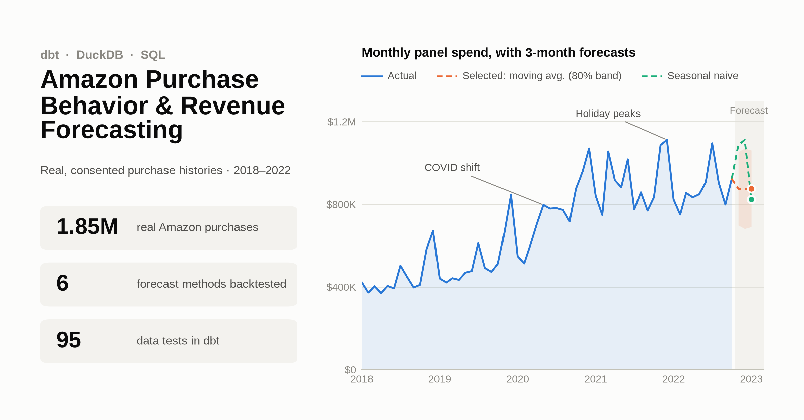
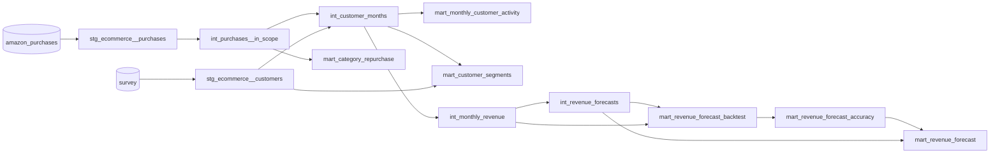

# Amazon Purchase Behavior & Revenue Forecasting with dbt

**Analytics Engineering Portfolio Project** · **애널리틱스 엔지니어링 포트폴리오 프로젝트**



> 🌐 **Language / 언어** — Click a heading below to expand or collapse it. / 아래 제목을 클릭하면 펼치거나 접을 수 있습니다.

<details open>
<summary><h2>🇺🇸 English</h2></summary>

A dbt pipeline over **real, consented Amazon purchase histories** (1.85M purchases from 5,027 U.S. accounts, 2018–2022) that answers three questions:

1. **Activity & retention:** How did purchase activity and month-over-month retention evolve, including through COVID?
2. **Repurchase:** Which product categories bring customers back, and how fast?
3. **Forecasting:** How much will the panel spend over the next 3 months, and which method has earned trust in an out-of-sample backtest?

**Stack:** dbt Core · DuckDB · dbt_utils · SQL only. `git clone` + `dbt build` reproduces everything; the data is in the repo.

---

### Dataset

**Open e-commerce 1.0** (Berke, Calacci, Mahari, Yabe, Larson & Pentland, 2023). Harvard Dataverse, [doi:10.7910/DVN/YGLYDY](https://doi.org/10.7910/DVN/YGLYDY). Paper: *Scientific Data* 11, 491 (2024). License: **CC0 1.0**.

- U.S. Amazon users exported their order history and shared it with informed consent in an MIT IRB-approved study.
- Each purchase row has the order date, unit price, quantity, shipping state, product code, title and category.
- A linked survey covers demographics and Amazon usage.
- Provenance is checked: the file's MD5 matches Dataverse, and the Parquet copy is verified lossless ([data/README.md](data/README.md)).

---

### Data quality findings → decisions

Profiling came before modeling. Every decision below is implemented in SQL and guarded by a test.

| Finding | Evidence | Decision |
|---|---|---|
| **Data ends at different dates per account** | Participants exported between Nov 2022 and Mar 2023. Last purchases fall in 2022-11 (1,218 accounts), 2022-12 (857), 2023-01 (312), 2023-02 (614) and 2023-03 (1,246) | Analysis window is **2018-01 to 2022-10**, the last month fully covered for everyone. This excludes 113,659 rows. A test checks that the forecast starts after the window |
| Stray future dates | 18 rows dated up to 2024-08, from 2 accounts | Excluded by the window |
| **Gift cards** | 27,734 rows, $0.90M | Excluded from spend: buying a gift card is a prepayment, and what it later funds is already in the data |
| **Exact duplicate rows, no order id** | 6,875 groups (11,624 extra copies) | Kept, because they can be genuine repeat orders. Each copy gets a unique key, and a `warn`-severity test keeps them visible |
| Missing category | 89,458 rows (4.8%) | Set to `UNKNOWN`; excluded from category metrics only |
| **Left-censoring** | Everyone's history starts in 2018; 85% of accounts' first observed purchase is in 2018, and 52% in Jan 2018 alone | No acquisition cohorts. Repurchase uses **new-to-category** buyers with a 12-month lookback instead |
| **Survivorship** | Eligibility required an Amazon account in use since 2018 and still active at the survey | Activity levels skew high, so the report reads trends and seasonality rather than levels |
| Account ≠ person | 1,481 accounts (29%) are shared by 2+ people | "Customer" means account, and account sharing is analyzed as a segment |
| Sensitive survey answers | Health, substance use, race, sexual orientation | Never selected. Segments under 50 accounts are suppressed |

---

### Architecture



| Layer | Models | Role |
|---|---|---|
| Sources | `amazon_purchases` (Parquet), `survey` (CSV) | Read straight from `data/raw` by DuckDB |
| Staging | `stg_ecommerce__purchases`, `stg_ecommerce__customers` | Type, rename and key the data; flag gift cards and duplicates; drop sensitive survey fields |
| Intermediate | `int_purchases__in_scope` | Analysis window and gift-card exclusion, in one place |
| | `int_customer_months` | Complete customer × month grid, so inactive months count as zeros |
| | `int_monthly_revenue`, `int_revenue_forecasts` | Monthly series; every method's forecast from every cutoff |
| Marts | `mart_monthly_customer_activity` | Active rate, month-over-month retention, spend per buyer |
| | `mart_category_repurchase` | 30/90/180-day repurchase by category |
| | `mart_customer_segments` | Spend by age, income, household size, account sharing |
| | `mart_revenue_forecast_backtest` / `_accuracy` / `mart_revenue_forecast` | Backtest, model selection, 3-month forecast |

---

### Results

#### 1. Activity & retention (`mart_monthly_customer_activity`)
- **Active rate** (share of accounts buying in a month) rose from **52% (Jan 2018) to 74% (Oct 2022)**.
- **Month-over-month retention** ranges from 76% to 90%. Every December is a local peak, with the high at **90.1% in Dec 2020**.
- **COVID shift:** panel spend rose **32% from Mar to May 2020** and never returned to the pre-2020 level. Spend per active account went from $162 (Jan 2018) to $249 (Oct 2022).

#### 2. Category repurchase (`mart_category_repurchase`, 1,009 categories)
- **Consumables pull customers back:** about 40–45% of new buyers repurchase within 90 days. Examples: bread 45.4%, poultry 43.8%, pet food 40.8%.
- **Durables almost never repeat:** cookware 0.8%, knife block sets 0%. The median category is 8.3%.
- This is the list a replenishment or subscription program should target.

#### 3. Segments (`mart_customer_segments`)
- **Account sharing is the strongest spend driver:** $105/month for single-user accounts versus $296 for accounts shared by 4+ people.
- **Income:** spend rises steadily from $86 (<$25K) to $224 ($150K+).
- **Age:** 45–54 spends the most at $173.
- These are self-reported and descriptive, not causal.

#### 4. Revenue forecasting & backtest
**Approach.**
- Six baseline methods are each fitted at every monthly cutoff on an expanding window: `naive`, `historical_mean`, `moving_average` (3m), `linear_trend` (OLS), `seasonal_naive` (same month last year), and `seasonal_naive_yoy` (seasonal naive × trailing YoY growth).
- Each cutoff forecasts 1–3 months ahead, giving 99 scored forecasts per method for targets from 2020-01 to 2022-10.
- The selection rule was fixed in advance: the lowest WAPE across all horizons wins.

| Method | WAPE, all horizons | WAPE 2020 | WAPE 2021 | WAPE 2022 | Bias (1-month) |
|---|---|---|---|---|---|
| `moving_average` ✅ selected | **13.9%** | 14.8% | 13.3% | 12.1% | −1.0% |
| `linear_trend` | 14.8% | 13.9% | 11.8% | 17.6% | +2.2% |
| `naive` | 15.7% | **11.5%** | 15.5% | 13.4% | −0.3% |
| `seasonal_naive_yoy` | 18.5% | 13.5% | 19.4% | 16.2% | +4.6% |
| `seasonal_naive` | 19.6% | 31.2% | 17.1% | **10.6%** | −16.2% |
| `historical_mean` | 30.3% | 31.9% | 32.2% | 22.7% | −29.2% |

*Per-year columns are 1-month-ahead WAPE (`analyses/forecast_error_by_year.sql`).*

**What the backtest shows:**
- **No method wins every regime.** During the 2020 jump, level-following methods win (`naive` 11.5%). Seasonal naive is worst there, because last year's level was far too low.
- **Once spending stabilized in 2022, seasonality dominates:** `seasonal_naive` is the best method that year (10.6%).
- `seasonal_naive_yoy` over-forecast 2021 by 15.7%, because it extrapolated the COVID growth spike.
- `historical_mean`, the winner on the earlier synthetic data, is the worst here. A 5-year series with a level shift punishes a long-run average.

**Live forecast** (trained through Oct 2022). The selected `moving_average` forecasts a flat **$875K per month** for Nov 2022 to Jan 2023, with an 80% interval of ±$177K to ±$194K depending on the horizon.

**Honest check against partial data.**
- Nov 2022 is only partly observed: for 1,218 accounts the data ends during November, so the figure is a **lower bound**.
- Even so, it is already **$1.054M**. That is above the moving-average forecast's 80% upper bound ($1.052M).
- `seasonal_naive` forecast $1.086M, which is consistent with it.
- **Lesson:** selecting on error averaged across a regime change hid the holiday seasonality. The rule was not changed after the fact. Instead, the fix goes on the roadmap: evaluate on a recent window and add a model with both level and seasonality (e.g. ETS) to the same harness.

---

### Data quality tests

`dbt build` runs **12 models and 95 tests**. All pass, plus 1 intentional warning that monitors duplicate rows.

**Generic tests:**
- `unique` / `not_null` on keys
- `relationships` (purchases → customers)
- `accepted_values`
- `dbt_utils.accepted_range` (rates within 0–100, segment size ≥ 50)
- `unique_combination_of_columns` on every model's grain

**Singular tests (`tests/`):**

| Test | Guards against |
|---|---|
| `assert_spend_reconciles_across_layers` | Spend lost or duplicated between purchases, the customer-month grid, the monthly series and the activity mart |
| `assert_customer_months_grid_is_complete` | Missing inactive months, which would inflate activity rates |
| `assert_backtest_has_no_lookahead` | Any forecast trained on data from or after its target month |
| `assert_seasonal_forecasts_use_only_past_data` | `seasonal_naive` not being exactly the month one year before, or not yet known at the origin |
| `assert_forecast_starts_after_analysis_window` | Training on incomplete months |
| `assert_one_selected_forecast_method` | Zero or multiple headline models |
| `assert_category_repurchase_rates_are_cumulative` | 30d > 90d > 180d inconsistencies |

**The tests were themselves tested.** Four deliberately injected bugs were all caught:
1. **One-month lookahead in training:** 612 failing rows, and downstream marts were blocked.
2. **Seasonal leak at a 13-month horizon:** 35 failing rows.
3. **Dropping inactive customer-months:** the grid test failed.
4. **Letting gift cards into spend:** the `accepted_values` test failed.

---

### Design decisions

| Decision | Rationale |
|---|---|
| Raw data as **dbt sources** over Parquet, not seeds | Seeds are for small reference tables. A lossless Parquet copy is 5× smaller than the CSV and versioned in git |
| Filters live in **one model** (`int_purchases__in_scope`) | The window and gift-card rules cannot drift between metrics |
| **Complete customer × month grid** | Correct denominators for activity and retention |
| **New-to-category** with lookback + full 180-day follow-up | Handles left- and right-censoring instead of ignoring them |
| One forecast model drives both **backtest and live forecast** | The evaluated code is the shipped code |
| **Selection rule fixed before seeing results** (WAPE) | Prevents tuning to the backtest; the miss is reported, not hidden |
| Window, horizon, lookback and privacy floor as **`vars`** | Tunable without code changes |
| Sensitive fields never selected, small segments suppressed | Respects the dataset's "do not re-identify" request |

---

### Getting started

```bash
git clone https://github.com/hbchoi0917/dbt-amazon-purchase-analytics.git
cd dbt-amazon-purchase-analytics
python -m venv .venv && source .venv/bin/activate   # Windows: .venv\Scripts\activate
pip install dbt-duckdb
dbt deps     # dbt_utils
dbt build    # 12 models + 95 tests, under a minute
```

`profiles.yml` is included and builds a local `dev.duckdb`.

To regenerate the chart at the top from the built models: `pip install matplotlib && python scripts/render_overview_chart.py`.

---

### Limitations
- **Representativeness:** the panel was crowdsourced via Prolific and CloudResearch. It is younger than the U.S. population and limited to people still active on Amazon. Results describe this panel, not Amazon.
- **Gross spend only:** returns and refunds are not in the export.
- **No order id:** "orders" are approximated by distinct purchase days, and exact duplicate rows are ambiguous.
- **Small backtest sample:** 32–34 forecasts per horizon, so the differences between the top three methods are small.

### Next steps
1. **Stronger forecasting:** add ETS or Prophet as a dbt Python model, score it in the same harness, and select on a recent evaluation window.
2. **Holiday planning view:** a seasonal model for Q4 alongside the level model.
3. **Replenishment targeting:** turn `mart_category_repurchase` into next-purchase-date predictions for consumable categories.

</details>

<details>
<summary><h2>🇰🇷 한국어</h2></summary>

**실제로 동의를 받아 수집된 Amazon 구매 이력**으로 만든 dbt 파이프라인입니다. 미국 5,027개 계정의 2018~2022년 구매 185만 건을 사용하며, 세 가지 질문에 답합니다.

1. **활동 & 리텐션:** 코로나 시기를 포함해 구매 활동과 전월 대비 리텐션은 어떻게 변했나?
2. **재구매:** 어떤 카테고리가 고객을 다시 오게 하고, 얼마나 빨리 다시 오나?
3. **예측:** 향후 3개월 패널 지출은 얼마이고, 표본 외 백테스트에서 믿을 만하다고 검증된 방법은 무엇인가?

**기술 스택:** dbt Core · DuckDB · dbt_utils · SQL만 사용. 데이터가 레포에 포함되어 있어 `git clone` 후 `dbt build`만 하면 전부 재현됩니다.

---

### 데이터셋

**Open e-commerce 1.0** (Berke, Calacci, Mahari, Yabe, Larson & Pentland, 2023). Harvard Dataverse, [doi:10.7910/DVN/YGLYDY](https://doi.org/10.7910/DVN/YGLYDY). 논문: *Scientific Data* 11, 491 (2024). 라이선스: **CC0 1.0**.

- MIT IRB 승인 연구에서, 미국 Amazon 사용자들이 직접 주문 이력을 내보내 동의하에 제공한 데이터입니다.
- 구매 행마다 주문일, 단가, 수량, 배송 주, 상품 코드, 상품명, 카테고리가 있습니다.
- 인구통계와 Amazon 사용 습관을 담은 설문이 연결되어 있습니다.
- 출처를 검증했습니다. 파일 MD5가 Dataverse 값과 일치하고, Parquet 변환본이 원본과 동일함을 확인했습니다([data/README.md](data/README.md)).

---

### 데이터 품질 점검 → 의사결정

모델링 전에 데이터 프로파일링부터 했습니다. 아래 결정은 모두 SQL로 구현되어 있고 테스트로 보호됩니다.

| 발견 | 근거 | 결정 |
|---|---|---|
| **계정마다 데이터가 끝나는 날짜가 다름** | 참여자들이 2022-11~2023-03 사이에 데이터를 내보냄. 마지막 구매월 분포: 2022-11 (1,218계정), 2022-12 (857), 2023-01 (312), 2023-02 (614), 2023-03 (1,246) | 분석 기간을 **2018-01 ~ 2022-10**으로 한정. 모든 계정이 온전히 포함된 마지막 달까지입니다. 이로써 113,659행이 제외되며, 예측이 기간 이후부터 시작하는지 테스트로 확인 |
| 미래 날짜 이상값 | 2개 계정의 18행이 2024-08까지 찍혀 있음 | 분석 기간 설정으로 제외 |
| **기프트카드** | 27,734행, $0.90M | 지출에서 제외. 기프트카드 구매는 선결제이고, 그 카드로 산 상품은 이미 데이터에 있음 |
| **완전 중복 행 (주문 ID 없음)** | 6,875그룹 (추가 사본 11,624행) | 실제 반복 주문일 수 있어 유지. 사본마다 고유 키를 부여하고, `warn` 테스트로 계속 모니터링 |
| 카테고리 누락 | 89,458행 (4.8%) | `UNKNOWN`으로 표기하고 카테고리 지표에서만 제외 |
| **좌측 절단** | 모두 이력이 2018년부터 시작. 계정의 85%가 첫 구매를 2018년에, 52%는 2018년 1월에 기록 | 신규 고객 코호트는 쓰지 않음. 대신 12개월 lookback 기준 **카테고리 신규 구매자**를 사용 |
| **생존 편향** | 참여 조건이 "2018년부터 쓰던 계정이 설문 시점까지 활성" | 활동 수준이 높게 나오므로, 절대 수준보다 추세와 계절성을 해석 |
| 계정 ≠ 사람 | 1,481계정(29%)을 2명 이상이 공유 | "고객"은 계정을 뜻하며, 계정 공유를 세그먼트로 분석 |
| 민감한 설문 항목 | 건강, 약물, 인종, 성적 지향 | 아예 선택하지 않음. 50계정 미만 세그먼트는 표시하지 않음 |

---

### 아키텍처

(lineage 다이어그램은 영문 섹션을 참고하세요.)

| 레이어 | 모델 | 역할 |
|---|---|---|
| Source | `amazon_purchases` (Parquet), `survey` (CSV) | DuckDB가 `data/raw`에서 직접 읽음 |
| Staging | `stg_ecommerce__purchases`, `stg_ecommerce__customers` | 타입·이름 정리와 키 부여, 기프트카드·중복 플래그, 민감한 설문 항목 제외 |
| Intermediate | `int_purchases__in_scope` | 분석 기간과 기프트카드 제외 규칙을 한 곳에서 적용 |
| | `int_customer_months` | 고객 × 월 전체 그리드. 구매 없는 달도 0으로 포함 |
| | `int_monthly_revenue`, `int_revenue_forecasts` | 월별 시계열, 모든 시점에서의 모든 방법 예측 |
| Mart | `mart_monthly_customer_activity` | 활성률, 전월 대비 리텐션, 구매자당 지출 |
| | `mart_category_repurchase` | 카테고리별 30/90/180일 재구매율 |
| | `mart_customer_segments` | 연령, 소득, 가구원 수, 계정 공유별 지출 |
| | `mart_revenue_forecast_backtest` / `_accuracy` / `mart_revenue_forecast` | 백테스트, 모델 선택, 3개월 예측 |

---

### 결과

#### 1. 활동 & 리텐션 (`mart_monthly_customer_activity`)
- **활성률**(그 달에 구매한 계정 비율)은 **52%(2018년 1월)에서 74%(2022년 10월)**로 올랐습니다.
- **전월 대비 리텐션**은 76~90% 범위입니다. 매년 12월이 고점이고, 최고치는 **2020년 12월 90.1%**입니다.
- **코로나 변화:** 패널 지출이 **2020년 3월에서 5월 사이 32% 증가**했고, 이후 2020년 이전 수준으로 돌아가지 않았습니다. 활성 계정당 지출은 $162(2018-01)에서 $249(2022-10)로 늘었습니다.

#### 2. 카테고리 재구매 (`mart_category_repurchase`, 1,009개 카테고리)
- **소모품은 다시 삽니다:** 신규 구매자의 약 40~45%가 90일 안에 재구매합니다. 예: 빵 45.4%, 가금류 43.8%, 반려동물 사료 40.8%.
- **내구재는 거의 재구매가 없습니다:** 조리도구 0.8%, 칼 블록 세트 0%. 전체 카테고리의 중앙값은 8.3%입니다.
- 정기배송이나 재구매 유도 프로그램이 공략할 대상이 바로 이 목록입니다.

#### 3. 세그먼트 (`mart_customer_segments`)
- **지출을 가장 크게 가르는 요인은 계정 공유입니다:** 1인 계정은 월 $105, 4인 이상 공유 계정은 월 $296입니다.
- **소득:** 지출이 $86(<$25K)에서 $224($150K+)까지 꾸준히 증가합니다.
- **연령:** 45~54세가 $173으로 가장 많이 씁니다.
- 자기보고 기반의 기술 통계이며, 인과관계가 아닙니다.

#### 4. 매출 예측 & 백테스트
**접근 방식**
- 6가지 베이스라인 방법을 매월 시점마다 expanding window로 학습합니다: `naive`, `historical_mean`, `moving_average`(3개월), `linear_trend`(OLS), `seasonal_naive`(작년 같은 달), `seasonal_naive_yoy`(seasonal naive × 최근 12개월 전년 대비 성장률).
- 각 시점에서 1~3개월 앞을 예측합니다. 방법당 99건을 채점했고, 대상 기간은 2020-01 ~ 2022-10입니다.
- 선택 규칙은 **미리 고정**했습니다: 전체 horizon 기준 WAPE가 가장 낮은 방법을 선택합니다.

| 방법 | WAPE 전체 | 2020 | 2021 | 2022 | 편향(1개월) |
|---|---|---|---|---|---|
| `moving_average` ✅ 선택 | **13.9%** | 14.8% | 13.3% | 12.1% | −1.0% |
| `linear_trend` | 14.8% | 13.9% | 11.8% | 17.6% | +2.2% |
| `naive` | 15.7% | **11.5%** | 15.5% | 13.4% | −0.3% |
| `seasonal_naive_yoy` | 18.5% | 13.5% | 19.4% | 16.2% | +4.6% |
| `seasonal_naive` | 19.6% | 31.2% | 17.1% | **10.6%** | −16.2% |
| `historical_mean` | 30.3% | 31.9% | 32.2% | 22.7% | −29.2% |

*연도별 값은 1개월 앞 예측의 WAPE입니다(`analyses/forecast_error_by_year.sql`).*

**백테스트가 보여준 것**
- **모든 국면에서 이기는 방법은 없습니다.** 2020년 급증기에는 수준을 따라가는 방법이 이겼습니다(`naive` 11.5%). 이때 seasonal naive는 작년 수준이 너무 낮아서 최악이었습니다.
- **지출이 안정된 2022년에는 계절성이 지배합니다:** 그해 최고 방법은 `seasonal_naive`(10.6%)입니다.
- `seasonal_naive_yoy`는 코로나 성장률을 그대로 연장해서 2021년을 15.7% 과대 예측했습니다.
- 합성 데이터에서 1위였던 `historical_mean`은 여기서 최하위입니다. 수준 변화가 있는 5년 시계열에서는 장기 평균이 크게 틀립니다.

**실제 예측** (2022-10까지 학습). 선택된 `moving_average`는 2022-11 ~ 2023-01에 **월 $875K**로 평평하게 예측하며, 80% 구간은 horizon에 따라 ±$177K ~ ±$194K입니다.

**부분 데이터로 한 정직한 점검**
- 2022년 11월은 일부만 관측됐습니다. 1,218개 계정의 데이터가 11월 중에 끝나므로, 이 값은 **하한**입니다.
- 그런데도 이미 **$1.054M**으로, moving average 예측의 80% 상한($1.052M)을 넘었습니다.
- `seasonal_naive`의 예측은 $1.086M으로, 이 값과 잘 맞습니다.
- **교훈:** 국면 변화를 가로지르는 평균 오차로 모델을 고르면 연말 계절성이 가려집니다. 그래도 규칙을 사후에 바꾸지 않고, 개선은 다음 단계로 남겼습니다: 최근 기간으로 평가하고, 수준과 계절성을 함께 다루는 모델(예: ETS)을 같은 하네스에 추가합니다.

---

### 데이터 품질 테스트

`dbt build`는 **모델 12개와 테스트 95개**를 실행합니다. 모두 통과하며, 중복 행 모니터링용 의도된 경고가 1개 있습니다.

**Generic 테스트:**
- 키에 `unique` / `not_null`
- `relationships`(구매 → 고객)
- `accepted_values`
- `dbt_utils.accepted_range`(비율은 0~100, 세그먼트는 50 이상)
- 모든 모델의 grain에 `unique_combination_of_columns`

**Singular 테스트 (`tests/`):**

| 테스트 | 막는 문제 |
|---|---|
| `assert_spend_reconciles_across_layers` | 구매 → 고객×월 → 월별 시계열 → 활동 마트 사이에 지출이 빠지거나 중복되는 것 |
| `assert_customer_months_grid_is_complete` | 구매 없는 달이 빠져 활성률이 부풀려지는 것 |
| `assert_backtest_has_no_lookahead` | 대상 월이나 그 이후 데이터로 학습한 예측 |
| `assert_seasonal_forecasts_use_only_past_data` | `seasonal_naive`가 정확히 1년 전 같은 달이 아니거나, 예측 시점에 아직 모르는 값인 경우 |
| `assert_forecast_starts_after_analysis_window` | 불완전한 달로 학습하는 것 |
| `assert_one_selected_forecast_method` | 대표 모델이 0개 또는 여러 개인 경우 |
| `assert_category_repurchase_rates_are_cumulative` | 30일 > 90일 > 180일 같은 모순 |

**테스트 자체도 검증했습니다.** 일부러 넣은 버그 4가지를 모두 잡아냈습니다.
1. **학습에 1개월 미래 데이터 누수:** 612행 실패, 하위 마트 빌드 차단.
2. **13개월 horizon에서 계절성 누수:** 35행 실패.
3. **구매 없는 고객×월 행 삭제:** 그리드 테스트 실패.
4. **기프트카드가 지출에 섞임:** `accepted_values` 테스트 실패.

---

### 설계 의사결정

| 결정 | 근거 |
|---|---|
| 원본 데이터는 seed가 아닌 Parquet 기반 **dbt source**로 | seed는 작은 참조 테이블용. 무손실 Parquet는 CSV의 1/5 크기이고 git으로 버전 관리됨 |
| 필터 규칙은 **한 모델**(`int_purchases__in_scope`)에만 | 분석 기간·기프트카드 규칙이 지표마다 달라지지 않음 |
| **고객 × 월 전체 그리드** | 활성률·리텐션의 분모가 정확해짐 |
| lookback과 180일 추적을 갖춘 **카테고리 신규 구매자** | 좌측·우측 절단을 무시하지 않고 처리 |
| 하나의 예측 모델이 **백테스트와 실제 예측**을 모두 생성 | 평가한 코드가 곧 배포되는 코드 |
| **선택 규칙을 결과를 보기 전에 고정**(WAPE) | 백테스트에 끼워 맞추는 것을 방지. 빗나간 부분도 숨기지 않고 보고 |
| 기간, horizon, lookback, 프라이버시 기준을 **`vars`**로 | 코드 수정 없이 조정 가능 |
| 민감 항목은 선택하지 않고 작은 세그먼트는 숨김 | 데이터셋의 "재식별 금지" 요청을 존중 |

---

### 시작하기

```bash
git clone https://github.com/hbchoi0917/dbt-amazon-purchase-analytics.git
cd dbt-amazon-purchase-analytics
python -m venv .venv && source .venv/bin/activate   # Windows: .venv\Scripts\activate
pip install dbt-duckdb
dbt deps     # dbt_utils
dbt build    # 모델 12개 + 테스트 95개, 1분 이내
```

`profiles.yml`이 포함되어 있어 로컬 `dev.duckdb`가 바로 만들어집니다.

맨 위 차트를 빌드된 모델로 다시 만들려면 `pip install matplotlib && python scripts/render_overview_chart.py`를 실행하세요.

---

### 한계
- **대표성:** Prolific과 CloudResearch로 모집한 패널이라 미국 전체 인구보다 젊고, 설문 시점에 Amazon을 쓰고 있던 사람만 포함됩니다. 결과는 Amazon 전체가 아니라 이 패널을 설명합니다.
- **총지출 기준:** 반품·환불 정보는 export에 없습니다.
- **주문 ID 없음:** "주문"은 구매일 수로 근사했고, 완전 중복 행은 실제 주문인지 판단할 수 없습니다.
- **작은 백테스트 표본:** horizon당 32~34건이라 상위 3개 방법의 차이는 크지 않습니다.

### 향후 계획
1. **예측 고도화:** ETS·Prophet을 dbt Python 모델로 추가해 같은 하네스로 채점하고, 최근 기간 기준으로 모델을 선택합니다.
2. **연말 계획용 뷰:** 수준 모델과 함께 4분기용 계절성 모델을 둡니다.
3. **재구매 타깃팅:** `mart_category_repurchase`를 소모품 카테고리의 다음 구매일 예측으로 발전시킵니다.

</details>
